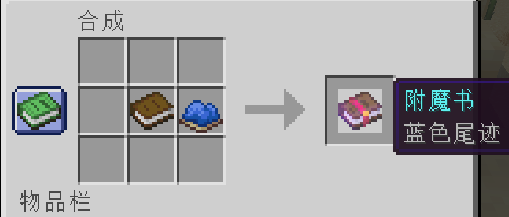

# 鞘翅尾迹 (Elytra Trails)

> 🛩️ 飞行时留下彩色尾迹！原版画风的鞘翅专属附魔模组。
>
> colorful · color trail · 尾迹 · 轨迹 · 彩色 · 粒子特效

---

## ⚠️ AI 构建声明

本项目**完全由 AI（Claude）构建**，仅经过人工代码审查和游戏内测试。

- 可能遗留未发现的 Bug
- 不保证与其他所有模组的兼容性
- 但经过实际测试，兼容性良好，与原版及常见模组无冲突

---

## 📋 适用版本

| 平台 | 版本 |
|------|------|
| Minecraft | **1.21.11** |
| Fabric Loader | **≥ 0.15** |
| Fabric API | **任意 1.21.11 版本** |

> ⚠️ 仅支持 Fabric，不支持 Forge / NeoForge。

---

## ✨ 功能

- **16 种颜色尾迹附魔**——对应全部染料，白/橙/品红/淡蓝/黄/黄绿/粉/灰/淡灰/青/紫/蓝/棕/绿/红/黑
- **大尾迹附魔**——粒子更大更亮，扩散范围可通过 gamerule 调节
- **多轨迹附魔**（最高 5 级，兼容至 255）——以默认轨迹为对称轴，两侧生成多条平行彩色尾迹
- 原版 `trail` 粒子，无缝融入游戏画风
- 二次贝塞尔曲线插值，高速拐弯平滑无毛刺
- 配置文件 + gamerule 双重控制，实时生效
- 原版工作台配方，JEI 完整支持

---

## 🎮 使用方式

### 合成

| 材料 | 产出 |
|------|------|
| 书 + 任意染料 | 对应颜色尾迹附魔书 |
| 书 + 火药 | 大尾迹附魔书 |
| 书 + 火药 + 燧石 | 多轨迹 I 附魔书 |



### 附魔

在铁砧上将附魔书打在鞘翅上即可。颜色尾迹之间互斥（同时只能存在一种颜色），大尾迹和多轨迹可与颜色尾迹共存。

> 💡 多轨迹高级书：铁砧合并两本同级书（I+I→II, II+II→III ...）；也可通过指令获得更高等级（兼容至 255）

### 配置

首次启动后生成 `config/elytra-trails.json`：

```json
{
  "spreadRadius": 1.0,
  "spawnInterval": 1,
  "trailDuration": 100
}
```

| 配置项 | 说明 | 默认 |
|--------|------|------|
| `spreadRadius` | 大尾迹扩散半径（格） | 1.0 |
| `spawnInterval` | 粒子生成间隔（tick） | 1 |
| `trailDuration` | 粒子持续时间（tick） | 100 |

### 游戏规则（gamerule）

| 命令 | 说明 | 默认 | 范围 |
|------|------|------|------|
| `/gamerule elytraTrailDuration 200` | 尾迹持续时间（tick） | 100 | 20~5000 |
| `/gamerule elytraTrailSpread 15` | 大尾迹扩散半径（10 = 1 格） | 10 | 0~100 |

> gamerule 优先级高于配置文件

---

## 🔧 技术细节

- **1 个 Mixin**：`PlayerEntity.tick()` 尾部注入，最小侵入、最高兼容
- 数据驱动的附魔系统（纯 JSON，17 个附魔定义）
- 原版 `minecraft:crafting_shapeless` 配方（18 个）
- 原版 `ParticleTypes.TRAIL` 粒子，零自定义纹理
- 多轨迹间距硬编码 0.5 格，粒子预算平分防截断

---

## 📜 开源协议

[MIT License](LICENSE)
